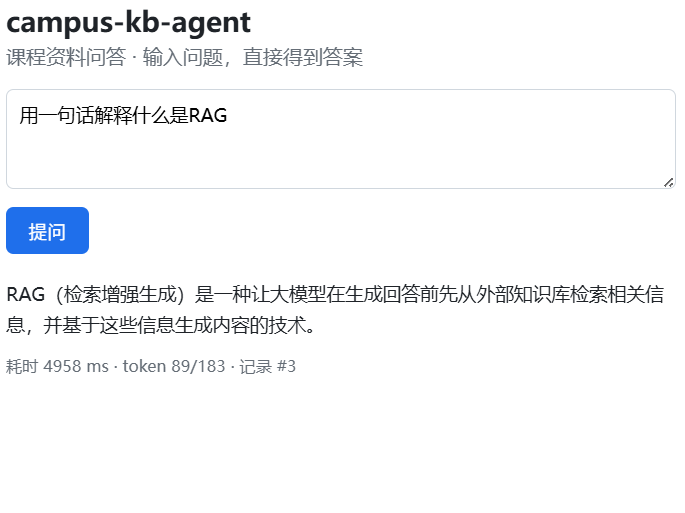

# campus-kb-agent

> 把散在群文件和网盘里的课程资料，变成一个能直接问的助手。

[](https://github.com/passgood-qq/campus-kb-agent/actions/workflows/ci.yml)

**状态**：开发中（WIP）· 2027 届春招项目

> **在线体验**：<http://101.201.74.52/>
> 部署在阿里云轻量应用服务器（2C1G），数据库用 Neon。若打不开可能是实例到期或关机。
> 部署步骤见 [`DEPLOY.md`](DEPLOY.md) 与 [`DEPLOY-ALIYUN-FC.md`](DEPLOY-ALIYUN-FC.md)



---

## 这是什么

找一份课程资料，通常要翻三五个群文件、几十条网盘链接，还不一定找得到。

本项目把课程资料统一收进来，做成可以用自然语言提问的知识库：
问一句"第三章讲了什么"，直接给出答案，并记录每次调用的耗时与成本。

**目标用户**：同专业的在读学生（也包括我自己）。

---

## 快速开始

### 1. 准备数据库

需要 PostgreSQL 16+ **并安装 pgvector 扩展**。

```bash
createdb campus_kb
psql -d campus_kb -f db/schema.sql
psql -d campus_kb -f db/migrations/002_chunks_embedding.sql
```

### 2. 配置并安装依赖

```bash
cp .env.example .env          # 填 LLM / Embedding 的 API Key，并让 DATABASE_URL 指向你的库
pip install -r requirements.txt
```

### 3. 灌库（切分 + 向量化）

```bash
python scripts/ingest.py      # 读 corpus/ 下的 txt/md → 切分 → embedding → 写进 chunks
```

### 4. 启动服务

```bash
python -m uvicorn app.main:app --port 8000
```

- 交互页面：<http://127.0.0.1:8000/>
- 接口文档：<http://127.0.0.1:8000/docs>

---

## 接口

| 方法 | 路径 | 说明 |
|---|---|---|
| `GET` | `/healthz` | 存活探针，返回服务与数据库状态 |
| `POST` | `/ask` | 传入问题，返回答案 + 耗时 + token + 记录 id |
| `GET` | `/docs` | Swagger 调试界面 |

`POST /ask` 响应示例：

```json
{
  "answer": "RAG（检索增强生成）是一种…… [1]",
  "sources": [
    {
      "index": 1,
      "title": "what_is_rag",
      "page_no": null,
      "chunk_index": 0,
      "score": 0.6455,
      "snippet": "什么是 RAG？RAG（检索增强生成）是一种……"
    }
  ],
  "latency_ms": 8381,
  "token_in": 358,
  "token_out": 509,
  "query_id": 8
}
```

> `query_id` 是故意返回的：接口成功不等于数据落库成功，能对账才算真的通了。

---

## 项目结构

```
├── app/
│   ├── main.py            # 入口、lifespan、首页、Swagger
│   ├── config.py          # pydantic-settings 读 .env
│   ├── schemas.py         # 请求/响应模型
│   ├── api/routes.py      # /ask、/healthz
│   └── services/
│       ├── llm.py         # LLM 调用封装，异常统一成 LLMError
│       └── db.py          # 连接池（懒加载）、queries 落库
├── scripts/
│   ├── test_llm.py        # 验证 LLM 通路
│   └── doc_pipeline.py    # 读文档 → 调模型 → 存库
├── tests/test_api.py      # 4 个接口测试
├── db/schema.sql          # documents / chunks / queries
├── docker-compose.yml     # 部署 / CI 用
└── .env.example
```

---

## 用户验证

手动访谈（样本很小，只作方向参考）：

| 对象 | 反馈 | 解读 |
|---|---|---|
| 同学 A | “不会用”，未说明原因 | 可能是非目标用户；访谈时也还没有可交互界面，只能凭描述想象 |
| 同学 B | “会用”，且在被问「要文件还是要解答」时明确选择**要解答** | 需求成立，且产品形态应是**带出处的回答**，而不是文件搜索器 |

**下一步**：让 1–2 个真实用户实际用一次，观察他们会问什么、是否追问、会不会第二次回来用。
口头上的“会用”不等于行为上的“会用”。

---

## 效果与评测

评测集 50 条（`eval/cases.json`），含 20% 负样本，判分为关键词匹配（确定性、可复现、不引入 LLM 评委）。

| 版本 | 改动 | 回答准确率 | 检索命中率 |
|---|---|---|---|
| v0 | chunk=500 / top_k=4 / 纯向量 | 94.0% | 97.6% |
| v1 | chunk=300 / overlap=60 / top_k=5 | 96.0% | 97.6% |
| v2 | + 关键词召回 + RRF 融合 | **98.0%** | **100%** |

v2 按类别：单跳 42/42、多跳 2/3、负样本 5/5。

**三个失败案例的根因（这是本项目最有价值的部分）：**

1. **「候选键的定义是什么」** —— `chunk=500` 把三级模式、关系模型、SQL 语法混成一块，
   向量被平均掉，真正含定义的那一段没进 top-4。切分降到 300 后解决。
2. **「WHERE 和 HAVING 有什么区别」** —— 纯向量检索对代码标识符不敏感，
   《数据库原理与应用》一次都没进 top-5。加关键词召回并用 RRF 融合后解决。
3. **「C++ 的指针和 Java 的引用有什么区别」** —— 多跳对照类问题，
   两块资料没能同时进上下文，模型按指令拒答。**未修复，属于已知局限。**

> 已知局限：多跳 / 对照类问题是当前最大短板（2/3）。需要 query 改写或拆成子问题分别检索。

**关于可复现性**：评测时生成温度固定为 `0`（见 `scripts/eval.py`）。

> 我曾经用 `temperature=0.3` 跑评测，同一套代码两次运行的数字差了 2 个百分点
> （98.0% → 96.0%），一度误以为是自己改坏了。**温度不为 0 时，任何优化对比都不成立。**
> 这是我在评测方法上踩过的一次真实错误。

---

## 可靠性设计

外部模型是最大的不稳定源，所以做了四件事：

| 机制 | 做法 | 故障注入实测 |
|---|---|---|
| 超时 | 单次调用 30s 超时 | 不会无限挂起 |
| 重试 | 指数退避 0.5s → 1s，最多 2 次 | 偶发失败自动恢复 |
| 熔断 | 连续失败 3 次打开，30s 后半开探测 | 故障期请求耗时 668ms → **171ms** |
| 降级 | 模型不可用时返回检索原文，`status=degraded` | HTTP 仍返回 200，不白屏 |

`python scripts/demo_degrade.py` 可复现整条链路（注入点是真的让 SDK 调用抛错）：

```
正常      status=ok        熔断器=closed
故障 x1   status=degraded  熔断器=closed  failures=1   823ms
故障 x2   status=degraded  熔断器=closed  failures=2   720ms
故障 x3   status=degraded  熔断器=open    failures=3   668ms
故障 x4   status=degraded  熔断器=open                171ms   ← 快速失败，不再重试
```

单元测试覆盖熔断器状态机、退避间隔序列与降级文案（不依赖数据库和真实模型）。

---

## 数据与隐私

- **语料**：公开教材与课程课件
- **评测集**：人工构造 50 条，含 20% 无答案负样本（第 8 周补齐）

> 本项目为个人学习项目，不含真实用户数据。`.env` 存有 API Key，已被 `.gitignore` 排除。

---

## 进度

- [x] D1 仓库、README、首次提交
- [x] D3 PostgreSQL + 初始 schema（3 张表）
- [x] D4 打通 LLM 调用（DeepSeek）
- [x] D5 端到端管线：读文档 → 调模型 → 存库
- [x] D6 日志与异常处理（退出码分级、超时重试）
- [x] 第 1 周 FastAPI 服务化：`/ask`、`/healthz`、首页、4 个测试
- [x] 第 2 周 文档切分 + 向量检索：pgvector 0.8.7 + HNSW，答案带出处
- [x] 评测集 50 条 + 评测脚本（准确率 98.0%，检索命中率 100%）
- [ ] 部署到公网

---

## 已知问题

- **整篇文档直接塞进 prompt，没有切分**：文档一长就超出上下文窗口，`chunks` 表目前是空的。
  下一步要做切分 + embedding 检索。
- **`chunks` 表暂未启用向量列**：向量维度要等 embedding 模型定下来才能建，见 `db/schema.sql` 注释。
- **还没有鉴权和限流**：当前只用于本地开发，未做公网防护。

---

## 做了什么取舍

- **本地开发用原生 PostgreSQL，不用 Docker**：启动快、少一层抽象，排查问题直接看日志。
  Docker 只用于部署和 CI。
- **先跑通端到端，再上向量检索**：先验证"读文档 → 调用 → 落库"这条链路，再替换成 RAG，避免一上来就堆组件。
- **只用 3 张表**：`query_sources` / `eval_cases` / `eval_runs` 等到第 8 周再建。
- **首页不使用任何外部 CDN**：国内网络下拉不到 Swagger 的静态资源会白屏，
  所以首页写成零依赖的纯 HTML，Swagger 的资源也换成了国内 CDN。
- **不用 `uvicorn[standard]`**：它的依赖 `pyyaml` 在 Python 3.15 下没有预编译 wheel，
  会退化成源码编译并要求 MSVC Build Tools。基础版 uvicorn 足够本地开发。

---

## License

MIT
